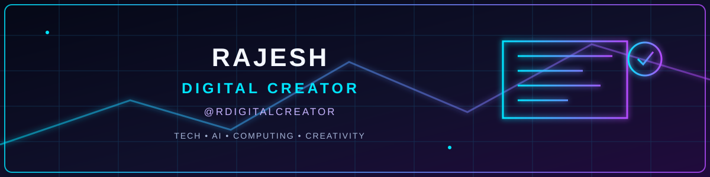

# RAJESH | DIGITAL CREATOR & IT PROFESSIONAL

### `@RDIGITALCREATOR` · World Best Computronix

---

## 👨‍💻 About Me

I'm Rajesh, an IT professional and digital creator from India. I explore technology, computer hardware, AI tools, web platforms, and digital storytelling.

**My mission:** Make technology simple, useful, and accessible.

## ⚡ What I Do

- 💻 Desktop & laptop repair, upgrades, and troubleshooting
- 🖥️ PC hardware: CPU, GPU, RAM, SSD, and HDD
- 🪟 Windows installation, optimization, and support
- 🤖 AI tools, image/video generation, and automation
- 🌐 Websites, web technologies, and digital platforms
- 🎬 Technology education and digital content creation

## 🏢 World Best Computronix

IT services and computer solutions.

- Desktop computer repair
- Laptop repair and maintenance
- Desktop & laptop accessories
- PC troubleshooting
- Windows installation and optimization

🌐 [worldbestcomputronix.com](https://www.worldbestcomputronix.com) · [worldbestcomputronix.in](https://www.worldbestcomputronix.in)

## 🧰 Tech Stack & Tools

  

## 🔭 Currently Exploring

- Generative AI and AI-assisted creative workflows
- AI image and video production
- Automation and productivity tools
- PC hardware, storage, and performance
- Web development and digital publishing

## 📈 GitHub Overview

## 🐍 Contribution Activity

## 🤝 Connect

- Instagram: [@RDIGITALCREATOR](https://www.instagram.com/rdigitalcreator/)
- YouTube: [World Best Computronix](https://www.youtube.com/@WorldBestComputronix)
- Website: [worldbestcomputronix.com](https://www.worldbestcomputronix.com)

---

### 💡 LEARN · BUILD · INNOVATE · INSPIRE

*Thanks for visiting my profile. Keep creating!*

